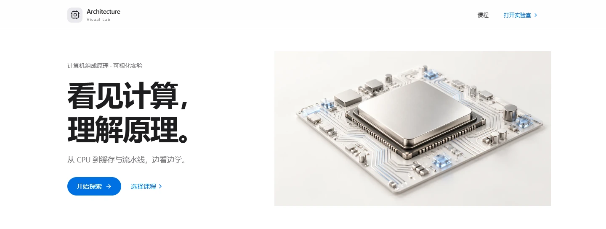

# Computer Architecture Visual Lab

让计算机组成，一目了然。一个可交互的 CPU、Cache 与 Pipeline 教学实验室。

[打开在线实验室](https://agcenn.github.io/computer-architecture-visual-lab/) · [部署指南](docs/DEPLOYMENT.md) · [教学模型](docs/MODELS.md)



## 35 秒认识实验室

[](https://agcenn.github.io/computer-architecture-visual-lab/media/architecture-trailer.mp4)

1080p 横版 · 中文字幕 · 原创电子配乐。跟随一条 ADD，观察数据流动、状态回退、Cache 命中与流水线 RAW 冒险。

[▶ 在线播放](https://agcenn.github.io/computer-architecture-visual-lab/media/architecture-trailer.mp4) · [MP4 文件](public/media/architecture-trailer.mp4) · [中文字幕](public/media/architecture-trailer.zh-CN.srt)

## 五个实验入口

| 实验 | 看什么 |
| --- | --- |
| [计算机概览](https://agcenn.github.io/computer-architecture-visual-lab/#/lab?module=overview) | 点击组件，认识 CPU 与存储 |
| [CPU 数据通路](https://agcenn.github.io/computer-architecture-visual-lab/#/lab?module=datapath) | 沿线路观察数据与控制信号 |
| [指令执行](https://agcenn.github.io/computer-architecture-visual-lab/#/lab?module=instruction) | ADD、SUB、LOAD、STORE、MOV；支持真实状态回退 |
| [Cache](https://agcenn.github.io/computer-architecture-visual-lab/#/lab?module=cache) | 直接映射、地址拆分、Hit / Miss 与命中率 |
| [Pipeline](https://agcenn.github.io/computer-architecture-visual-lab/#/lab?module=pipeline) | 五级流水、周期时序与 RAW 冒险 |

用单步、播放和回退，把每个过程慢下来。其他课程在首页的规划列表中。

## 本地运行

安装 Node.js 22.12 或更新的兼容版本，在包含 `package.json` 的项目目录运行：

```sh
npm install
npm run dev
```

验证生产版本：

```sh
npm test
npm run build
npm run preview
```

## 部署与模型说明

推送到 `main` 后，GitHub Actions 自动测试、构建并部署 `dist/`。Vite 已配置仓库 base path，HashRouter 支持刷新实验页面。

指令的六步是单周期数据传播的观察点；Pipeline 是五级流水的周期排程，首版只检测 RAW。Cache 采用 16 位字节地址、4 行、4 字节块。详细语法、边界与教学依据见[模型说明](docs/MODELS.md)。

React · TypeScript · Vite · Three.js · Zustand。所有实验直接在浏览器运行。

[验证记录](VERIFICATION.md) · [配图与提示词](docs/VISUAL_ASSETS.md)
